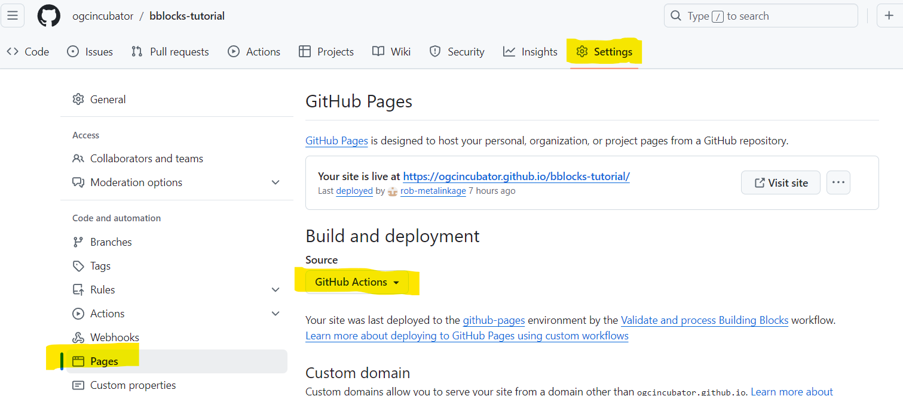
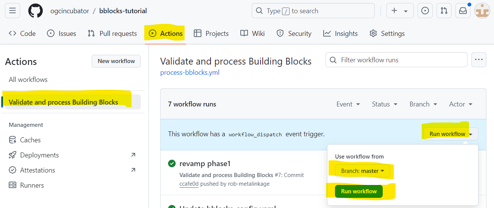
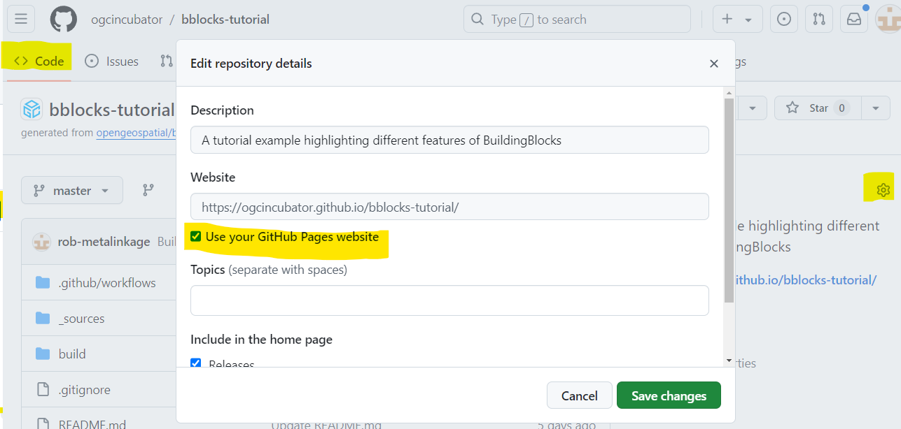
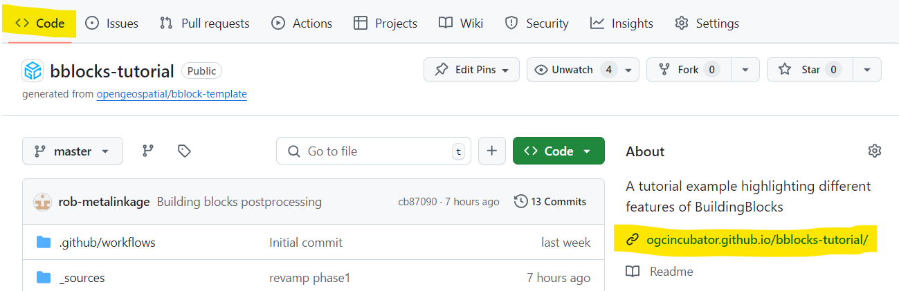
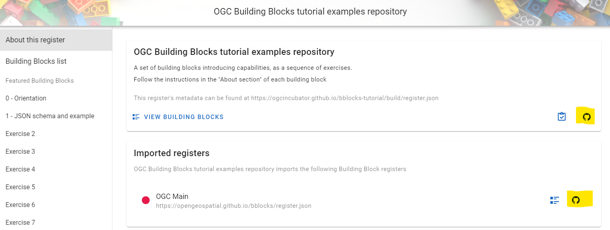

# Configuring Github automations for CI/CD build

New and forked Github repositories need configuration to allow automated building.

1. Fork the template or another repository to a GitHub organization (or personal account) you have admin access to.
   - If you forked an existing repository (rather than starting from the template), GitHub disables Actions
     workflows by default on forks — enable them on the "Actions" tab first, or the next steps won't run. See
     [Contributing updates to Building Blocks](contribution.md) for details and a screenshot.
2. In settings set "pages build" to "Github actions"
   (or, to publish to a branch instead, follow [Publishing to a branch](#publishing-to-a-branch) below)

3. Run the "validate and postprocess" action

4. Link the generated output pages to the repo overview by selecting "show"


You can now navigate between repository sources and the published Building Blocks:





## Publishing to a branch

By default the postprocessing workflow commits the generated `build/` directory to your source branch and deploys
the site to GitHub Pages through GitHub Actions. As an alternative, it can publish the built site to a separate
branch (`gh-pages` by default), which keeps build output out of your source branch while it remains browsable and
versioned in git. This also avoids the [`build/` merge conflicts](contribution.md#avoiding-build-resource-merge-conflicts)
on pull requests.

1. Add the following to `bblocks-config.yaml` (the default `mode` is `artifact`, the behavior described above):

   ```yaml
   deploy:
     mode: branch      # "artifact" (default) or "branch"
     branch: gh-pages  # only used in "branch" mode; default gh-pages
   ```

2. Run the "validate and postprocess" action. The first run creates the branch and publishes the site to it;
   it will warn that Pages is not serving that branch yet.
3. In the repository settings, set Pages "Source" to "Deploy from a branch", with the `gh-pages` branch and the
   `/ (root)` folder. The branch can't be selected until the first run has created it.
4. Run the action again (or push). From now on the Pages source is checked at the start of each run, and the run
   fails if Pages is not serving the configured branch.

If you are switching an existing register, also stop tracking `build/` on the source branch: add it to
`.gitignore` and run `git rm -r --cached build`. Registers created from the template don't track `build/` to begin with.

Notes:
* A custom domain requires setting the `base_url` workflow input explicitly.
* When a SPARQL endpoint is configured, the workflow waits for GitHub Pages to serve the new `register.json` before
  uploading to the triplestore.
